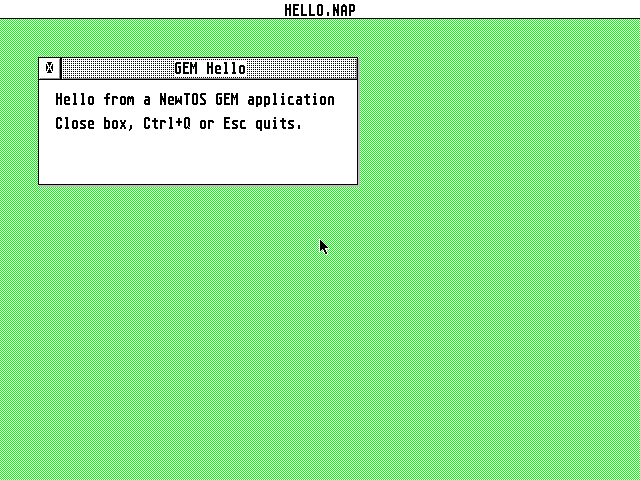

# 16 — `newtos-cc`, `newtos.mk` and the templates

Stand 2026-10-20, TASK/SDK01 package D, written against `main` at `e0692de7`
plus the package-D working tree. Evidence:
`measurements/measurement-2026-10-20-sdk01d/RUNINFO.TXT`.

This chapter covers only the three tools: the compiler wrapper
`sdk/bin/newtos-cc`, the Makefile include `sdk/mk/newtos.mk` and the two
templates in `sdk/templates/`. Installing the toolchain is
[02](02-prerequisites.md); a quick start from nothing is TASK/SDK01
package C (not written yet); what the programs do at start-up is
[03](03-first-programs.md) and [05](05-abi-pitfalls.md).

**What they do not do.** They do not build the SDK libraries. Before the
first use, the libraries you link must have been built once by their scripts
(`sdk/libc/build-libc.sh`, `sdk/gemlib/build-gemlib.sh`, …; the wrapper names
the right one when something is missing). Nor do they notice that a library is
**out of date** after you changed an SDK source: run the library's build script
(or a `build-*.sh` that calls `lib_ensure`) yourself in that case.
`newtos.mk` relinks your program when an archive under `sdk/` is newer than it.

## 1. `newtos-cc`

```
sdk/bin/newtos-cc [kind] [options] files...
```

A POSIX `sh` script. It finds the SDK from its own location (`sdk/bin/..`,
through symlinks; `NEWTOS_SDK` overrides), so it can be called by absolute
path, put on `PATH`, or linked into `~/bin`. It compiles `.c`/`.S`/`.s`
files and links them, with `.o`/`.a` files you pass, into one program.

What it runs is what the build scripts run (`newtos-cc -v` prints every
command):

| Step | Command |
|------|---------|
| compile | `clang -target aarch64-unknown-none-elf -ffreestanding -nostdlib -O2 -fPIE -fno-builtin -nostdinc -D__NEWTOS__ -Wno-macro-redefined` + your flags + `-I` of the selected libraries + `-I sdk/libc/mintlib/include` + (with `-lm`) `-I sdk/libm/include -I sdk/libm/openlibm-*/include` + `-isystem <clang resource dir>/include` |
| crt0 | `sdk/libc/crt0.S`, assembled per link; with `-prgflags`/`-prot` as `-DNEWTOS_PRGFLAGS=<value>` |
| link | `rust-lld -flavor gnu -T sdk/newtos.ld -pie --no-dynamic-linker -z text -z max-page-size=0x1000 --build-id=none crt0.o <objects> --start-group <archives> --end-group` |

Your flags come after the defaults, so `-Os` replaces `-O2`; your `-I`
directories are searched before the SDK's. The include order (libraries above
gemlib, gemlib, mintlib, libm's adapters, clang's headers) and the archive
order (`libshare` first, then `windom cflib ldg png z jpeg gif exif gem m`,
`libc` last, all in one group) are those of `build-qed.sh`,
`build-ldg-demo.sh` and `build-zview.sh`.

### Program kind

| Option | Output | Meaning |
|--------|--------|---------|
| `-ncp` | `.NCP` | console program (default) |
| `-ntp` | `.NTP` | console program; the desktop asks for a command line |
| `-nap` | `.NAP` | GEM application; implies `-lgem` |
| `-nac` | `.NAC` | desk accessory; implies `-lgem` (the libc crt0 handles the accessory start, [03](03-first-programs.md)) |
| `-nld` | `.NLD` | LDG module; implies `-lshare -lldg` with `libshare.a` first, and runs the allocator check of `sdk/libshare/libshare-link.sh` on the link map ([10](10-ldg-modules.md) §2, §6) |
| `-bare` | — | no libc: `sdk/crt0.S` and `sdk/include/newtos.h` only, `sdk/build.sh`'s flags; combines with a kind, refuses `-l` |

Without a kind option the kind comes from the `-o` extension, else `-ncp`.
The file is the same ELF for every kind; the extension decides how the desktop
starts it ([01](01-overview.md)). Without `-o` the output is the first
source's name with the kind's extension. A name longer than 8.3 or an
extension that does not fit the kind gives a warning.

### Libraries

Each `-l` selects the library's headers when compiling **and** its archive
when linking — so pass the same `-l` options to both steps when you compile
with `-c` (`newtos.mk` does). libc is always linked (except `-bare`).

| Option | Archive | Pulls in | Build script if missing |
|--------|---------|----------|-------------------------|
| `-lgem` | `sdk/gemlib/gemlib.a` | | `sdk/gemlib/build-gemlib.sh` |
| `-lcflib` | `sdk/cflib/cflib.a` | gem | `sdk/cflib/build-cflib.sh` |
| `-lm` | `sdk/libm/libm.a` (OpenLibm) | | `sdk/libm/build-libm.sh` |
| `-lldg` | `sdk/ldg/libldg.a` | gem | `sdk/ldg/build-ldg.sh` |
| `-lshare` | `sdk/libshare/libshare.a` | ldg | `sdk/libshare/build-libshare.sh` |
| `-lwindom` | `sdk/windom/libwindom1.a` | gem | `sdk/windom/build-windom.sh` |
| `-lz` `-lpng` `-ljpeg` `-lgif` `-lexif` | `sdk/{zlib,libpng,libjpeg,giflib,libexif}/lib*.a` | png: z, m; exif: m | `sdk/<lib>/build-<lib>.sh` |

An unknown `-lfoo` is an error; pass a foreign archive as a file
(`mylib.a`). Header trees are found by pattern (`sdk/gemlib/gemlib-*` with
`mt_gem.h`, …), so a library version bump does not need a wrapper change.

### PRGFLAGS and memory protection

| Option | Effect |
|--------|--------|
| `-prgflags V` | the PRGFLAGS long in the program's ELF note (`0x..` or decimal; default `7` = `PF_STANDARD`) |
| `-prot M` | the protection mode in bits 4–7 of PRGFLAGS: `private` (0x00), `global` (0x10), `super` (0x20), `readable` (0x30) — FreeMiNT's `F_PROT_*`, decoded by the kernel as `tos-types` `prot_from_prgflags` |

`-prot global` alone gives `0x17`; `-prgflags 0x3 -prot readable` gives
`0x33` (checked with `cargo xtask prgflags`). The note format and the loader
rules are in `docs/api/gemdos/process/4b-pexec.md` ("PRGFLAGS of a NewTOS
program", "Rights of the started process"); the protection mode matters only
while the kernel runs with memory protection (`memprot=on`, the default, or
`strict`).

### Other options

`-c`, `-S`, `-E` stop after compiling / assembly / preprocessing, as `cc`
does. `-Wl,a,b` passes `a` and `b` to the linker (e.g. `-Wl,-Map=prog.map`).
`-v` prints each command. Every other option goes to clang when compiling
(`-O*`, `-g`, `-W*`, `-f*`, `-D`, `-U`, `-I`, `-include`, `-isystem`, `-std=`,
`-MMD`, `-MF` …). Environment: `CLANG` (default `clang`), `LLD` (default: the
`rust-lld` of the Rust toolchain that `rustc` reports **when asked from inside
the SDK directory** — inside this repository the nightly pinned in
`rust-toolchain.toml`, whatever directory you build in — else `ld.lld`, then
`rust-lld` from `PATH`), `NEWTOS_SDK`.

### Examples

```sh
N=sdk/bin/newtos-cc
$N -o HELLO.NCP hello.c                         # console program, libc
$N -nap -Os -Wall -o MYAPP.NAP main.c win.c     # GEM application, gemlib + libc
$N -nap -lcflib -lm -o EDIT.NAP *.c             # + cflib, OpenLibm
$N -nld -lm -o CODEC.NLD codec.c                # LDG module (libshare, libldg, gemlib)
$N -ncp -prot global -o SHARED.NCP shared.c     # PRGFLAGS 0x17
$N -bare -o TINY.NCP tiny.c                     # no libc, as sdk/build.sh
$N -nap -c -MMD main.c -o build/main.o          # compile only
$N -nap build/main.o build/win.o -o MYAPP.NAP   # link only
```

Errors name the missing piece, for example

```
newtos-cc: error: headers of 'gem' not found -- the library is not built yet; run sdk/gemlib/build-gemlib.sh
newtos-cc: error: gemlib.a is not built (…/sdk/gemlib/gemlib.a missing); run sdk/gemlib/build-gemlib.sh
newtos-cc: error: unknown library -lfoo (known: gem cflib m ldg share windom z png jpeg gif exif; pass other archives as .a files)
```

### Same bytes as the scripts

Measured on 2026-10-20 (`measurements/measurement-2026-10-20-sdk01d/checks/compare.txt`):
built with the wrapper, these programs are **byte-identical** to the ones
their scripts build — `sdk/build.sh` `hello.c` (`-bare`), `TESTGEM.NAP`
(`-nap -Os -fomit-frame-pointer -funsigned-char -D_TOS_ONLY`), CoreMark
`CORE.NCP` and `COREVAL.NCP` (six sources), `EX_LIB.NLD` (`-nld -lm`) and
`LDGTEST.NCP` (`-lldg -lm`). One thing had to match by hand: the **order of
the object files**. `build-coremark.sh` links its objects by glob
(`core_*.o`, so `core_portme.o` sits between `core_matrix.o` and
`core_state.o`); with `core_portme.c` given last the program was the same size
but laid out differently. The extra `-D__NEWTOS__` and `-Wno-macro-redefined`
and the `--start-group` around a lone `libc.a` changed no byte.

## 2. `newtos.mk`

A Makefile include for GNU make (3.81, as shipped with macOS, or newer).

```make
PROG   = MYAPP          # name without extension; 8.3
KIND   = nap            # ncp | ntp | nap | nac | nld  (default ncp)
SRCS   = main.c win.c   # .c / .S, relative to the Makefile
LIBS   = -lcflib -lm    # newtos-cc library options
RSC    = myapp.rsc      # copied by `make card` (optional)
CFLAGS = -Os -Wall      # optional
# optional: LDFLAGS (-Wl,...), PRGFLAGS, PROT, BARE = 1, EXTRA (more files for
# `make card`), BUILD (object directory, default build), NEWTOS_CC
NEWTOS_SDK ?= /path/to/sdk
include $(NEWTOS_SDK)/mk/newtos.mk
```

| Target | Does |
|--------|------|
| `make` | compiles each source to `$(BUILD)/<name>.o` (with `-MMD -MP`, so header changes rebuild), links `$(PROG).<KIND>` |
| `make card DEST=<folder>` | copies the program, `$(RSC)` and `$(EXTRA)` into `<folder>` (created if needed), e.g. a folder on a mounted card; on macOS with `cp -X` and without leaving `._*` AppleDouble files of the copied names ([06](06-image-and-testing.md)) |
| `make clean` | removes `$(BUILD)` and the program |

`PROG`, `KIND`, `SRCS` (and `BUILD`) must be set **before** the include;
the other variables may also come after it. A change to the Makefile rebuilds
the objects and the program; a newer archive under `sdk/` relinks it.
`make card` copies; it does not create `NEWDESK.INF` lines, unmount or eject
anything.

## 3. Templates

| Directory | Builds | Shows |
|-----------|--------|-------|
| `sdk/templates/gem-hello/` | `HELLO.NAP` | `appl_init`, a VDI workstation, one window (title via `wind_set_str`, closer, mover), the `WM_REDRAW` rectangle-list loop, `WM_TOPPED`/`WM_MOVED`, a `form_alert` to confirm quitting (close box, Ctrl+Q, Esc), and a clean exit (window closed and deleted, `v_clsvwk`, `appl_exit`) |
| `sdk/templates/console-hello/` | `HELLO.NCP` | mintlib `printf`/`malloc`, `argc`/`argv`, `getenv`, a GEMDOS call (`Sversion`); ends by itself, so it can run from `C:\AUTO\` |

Inside the repository: `make -C sdk/templates/gem-hello`. To start a project,
copy the directory and build with `make NEWTOS_SDK=/path/to/sdk` (or edit the
`NEWTOS_SDK ?=` line). Run in QEMU `raspi4b` with memory protection on
(RUNINFO above): `HELLO.NCP` from `C:\AUTO\` printed its lines and ended;
`HELLO.NAP`, started by a `#Z` line, drew its window; with a scratch-kernel
key injector, Esc opened the alert and Return chose *Quit* — the program ended
with `rc=0` and the desktop came up.



## 4. What is untested

* **Linux.** Not run on Linux. The wrapper and the host test are written for
  POSIX `sh` and were run with macOS `/bin/sh` and with `dash`; `newtos.mk`
  uses only GNU make 3.81 features; `make card` uses `cp` there (`cp -X`
  only on macOS). The toolchain lookup (`clang`, `rustc`'s `rust-lld` or
  `ld.lld`) and the library build scripts themselves (bash, `md5`/`md5sum`
  …) have not been tried on Linux, and the SD-image tool is macOS-only
  (TASK/SDK01 package G).
* **`.NAC` and `.NTP` built with the wrapper** link, but were not started;
  `-lwindom -ljpeg -lgif -lexif -lshare` were checked for headers (compile)
  and `-lcflib -lm -lpng` for a link, not run.
* **A real Pi 4.** Nothing of this chapter ran on hardware; interactive use of
  the GEM template (mouse on the close box, moving the window) is
  hardware-only — in QEMU only the keys sent by the scratch injector were.
* **`ld.lld` instead of `rust-lld`** was not tried; byte identity with the
  scripts holds for the same `rust-lld`.
